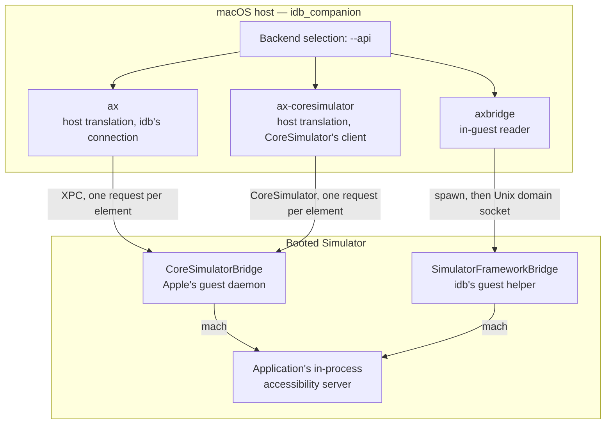
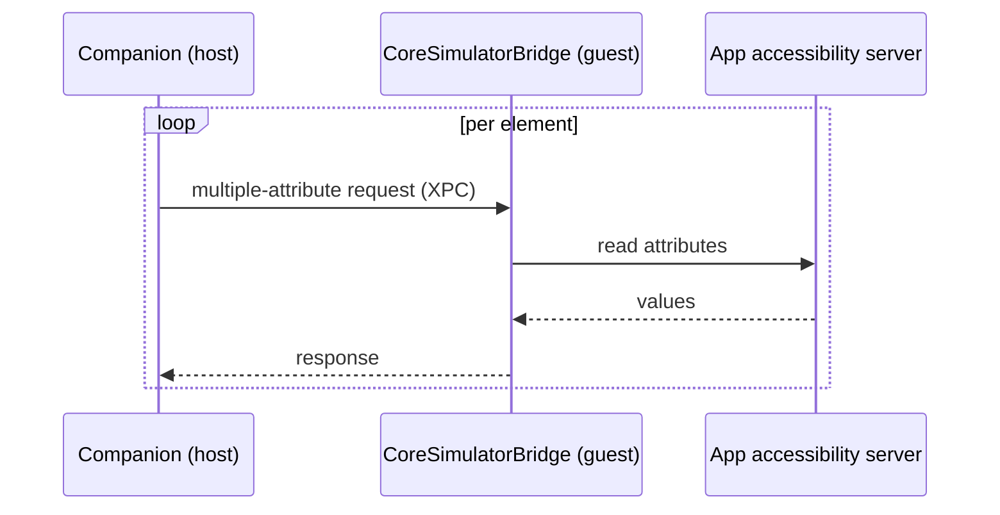
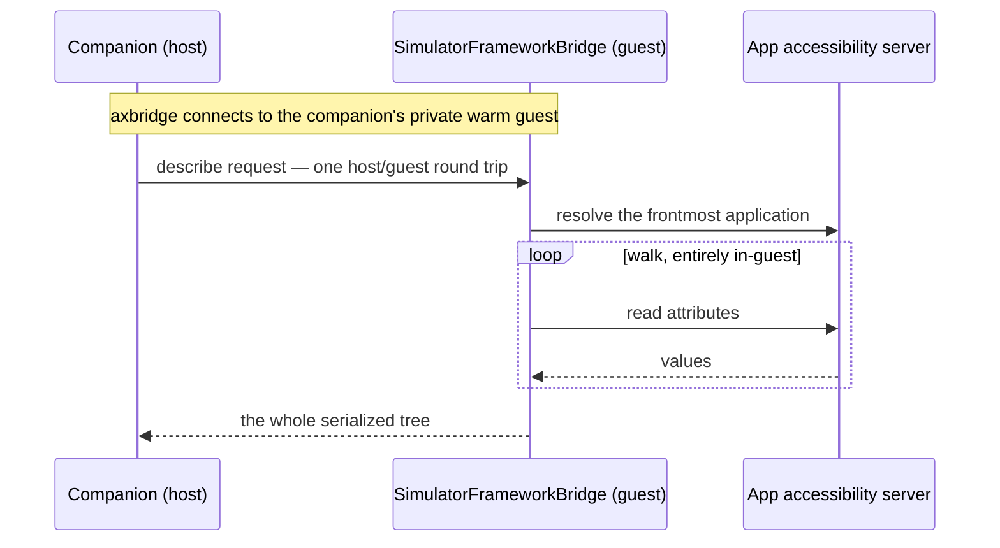

# FBSimulatorAX

Reads and drives the accessibility tree of an iOS Simulator's frontmost application, without a test bundle. It is the Simulator's accessibility capability, added onto `Simulator` from outside `FBSimulatorControl`: a consumer that does not read accessibility does not link it.

It holds the accessibility model its readers answer with, and builds on `FBSimulatorControl`, whose display routing it reads through, on [`FBSimulatorServices`](../FBSimulatorServices/README.md), whose guest bridge client the in-guest reader uses, and on [`FBSimulatorBridgeProtocol`](../FBSimulatorBridgeProtocol/README.md), the vocabulary it and the in-guest reader share.

It is what serves `idb`'s accessibility reads and element actions, and it can be linked directly by any process that wants to read and drive a Simulator's screen the same way. That supports:

- UI testing without `XCTest`, by reading the UI state and then driving the screen.
- Remote access to a Simulator, and screencasting.
- Accessibility auditing, by reading the whole hierarchy and applying heuristics to it.

This page is the one place the accessibility path is documented. The `idb ui` commands themselves are documented in [UI Automation](https://www.fbidb.io/idb/ui); the sections below cover what sits behind them: which backend serves a read, what shape the result comes back in, what a read costs, and what to do when one comes back emptier than the screen looks. [The Swift API](#the-swift-api) closes the page, for a consumer linking the library rather than running `idb`.

## Backends

A read or an action is served by one of three backends, selected with `--api` — on `idb ui describe-all`, `idb ui describe-point` and `idb ui describe`, and on `idb ui tap`, `idb ui scroll`, `idb ui set-value` and `idb ui drag-and-drop`. Two are **host** backends and one is the **guest**:

- **Host — `ax` and `ax-coresimulator`.** The companion translates the application's tree on the macOS host and asks CoreSimulatorBridge, Apple's daemon inside the Simulator, for each element. The two read the same tree in the same way and differ only in the connection their requests travel over.
- **Guest — `axbridge`.** idb's own helper runs inside the Simulator and reads the tree there, sending the host the result.

Where the work runs determines how much of the screen a backend can see and how much each read costs.

The two defaults differ, deliberately. A read defaults to `ax`, so a caller who asks for nothing gets a host read and does not assert automation mode on the device. An action defaults to `axbridge`, because a host backend cannot reach an element in another process and an action that cannot find its element is a failure rather than a smaller answer.

Every backend ultimately reads the same source of truth — the accessibility server running *inside* the target application — but they reach it along different paths:



### Host backends: `--api ax` and `--api ax-coresimulator`

The companion translates the frontmost application's tree on the host, through the private `AccessibilityPlatformTranslation` framework that `Simulator.app` uses. Its requests go to `com.apple.CoreSimulator.accessibility`, the service CoreSimulatorBridge vends inside the Simulator, which asks the application.

This is the same view an assistive technology gets. It is cheap and needs nothing installed in the Simulator, but composed views report as single elements: a view that draws its own content and describes itself with a single label — a custom collection view cell, a composed row of text and images — is reported as that one element, not as the parts it was built from.

The cost model follows from where the read runs: the host walks the tree one element at a time, and each step is a round trip into the Simulator. Everything a read needs of an element is asked for in one multiple-attribute request and converted on the host, so a read costs one round trip per element. The service answers them one at a time, so sending them concurrently does not help.

On an iOS 27.0 Calendar screen read as `xctest` (159 elements), that is 159 round trips and about 99 ms, where fetching each attribute in a request of its own took over ten round trips per element; the default, flattened tree of a screen is typically a dozen or so elements. axbridge's [single fetch](#how-axbridge-fetches-the-tree) reads a whole tree in one round trip, so a gap remains and it grows with the tree, but on the small trees most reads return it is a few milliseconds.



The two host backends differ only in how a request reaches the service:

- **`ax`** — the default for reads — holds its own XPC connection to the service, one per Simulator, and reconnects on the next read when CoreSimulatorBridge restarts. When the service cannot be reached directly, its requests go through CoreSimulator's client instead.
- **`ax-coresimulator`** always sends them through CoreSimulator's own client, `-[SimDevice sendAccessibilityRequestAsync:…]`: the path `Simulator.app` uses, at the cost of a hop through CoreSimulator's queues. Use it to compare against `ax`, or where idb's own connection misbehaves.

### Guest backend: `--api axbridge`

The read runs *inside* the Simulator. The companion starts the bundled `SimulatorFrameworkBridge` helper in `serve` mode, connects over a private Unix domain socket, and reuses that guest for later requests.

Because it reads the application from the inside, it sees the structure the application actually built, at the granularity `XCUITest` would see — typed, labelled elements where a host read reports one composite. It needs no test bundle, test runner, or automation daemon.

The first request pays for the helper to start and load the accessibility frameworks. Later requests reuse the warm guest, so their cost is dominated by the tree walk rather than process startup. If the guest exits, the next read reconnects or starts a replacement and retries once.

A guest read also puts the target into automation mode and leaves it there — see [Automation mode](#automation-mode).

### Choosing between them

| | `ax` | `ax-coresimulator` | `axbridge` |
|---|---|---|---|
| Where the read runs | Host | Host | Inside the Simulator |
| How requests reach the Simulator | idb's own XPC connection to CoreSimulatorBridge | CoreSimulator's accessibility client | idb's guest helper over a Unix domain socket |
| Detail | Assistive-technology view | Assistive-technology view | Full application tree |
| Cost per read | One round trip per element, with nothing to start | One round trip per element, through CoreSimulator | One round trip for the tree once warm, after a one-off start |
| Sees content drawn by another process | No | No | Yes |
| Sets automation mode | No | No | Yes |
| Needs `SimulatorFrameworkBridge` | No | No | Yes |
| Best for | Quick checks; the default read | Comparing against `ax`; a fallback when idb's connection misbehaves | Full-detail and repeated reads; actions |

### How axbridge fetches the tree

Both axbridge backends ask the application for the whole tree in **one** call. A subtree drawn by another process — a web view's page, a photo picker, an autofill sheet — is not in that application's answer, so the read continues with one more call per such subtree, served by the process drawing it. The alternative, one call per node, reads the same tree and the same attributes for more round trips; `profile` reports which one served a read, as `traversal`.

On a 167-element Settings screen the one call costs 1 mach round trip instead of 167, for the same document. On an idle screen the read time is comparable for either traversal (roughly 30ms); the saving grows with tree size and with how busy the application is.



**A read that asks about reachability takes the per-node walk instead.** The application hit-tests every node to answer `interactable` or `occluded_by`, and a single call asking for them times out rather than answering: on that same idle screen it fails every time at around four seconds, where the walk answers in about 1.6s. Nothing is needed from the caller — such a read reports `traversal: view-hierarchy`. A caller who explicitly asks for the single fetch together with a reachability key is refused with an error naming the keys, rather than left to that timeout.

Narrowing a read with `--key` does not put it on that path unless a reachability key is among the keys asked for — the ordinary attributes are not hit-tested.

The host backends are unaffected. They read element by element, as [described above](#host-backends---api-ax-and---api-ax-coresimulator), and report no `traversal` at all, but what it reads is the translator's vocabulary: the same one as axbridge's `semantic` traversal, described next.

### Vocabularies and traversals

A traversal is two choices at once: **whose attributes** the read asks the application for, and **how many calls** it takes to fetch them.

| | One call per node | One call for the tree |
|---|---|---|
| **XCTest's attributes** (the tree the application built, as `XCUITest` sees it) | `view-hierarchy` | `single-fetch` |
| **The accessibility translator's attributes** (what an assistive technology sees) | `semantic`, and every host read (`ax`, `ax-coresimulator`) | — |

The host backends and axbridge's `semantic` traversal read the same vocabulary and return the same default tree: on an iOS 27.0 Settings screen, 14 elements one level deep from both, against 152 elements 21 levels deep from `view-hierarchy` or `single-fetch`. Only the translator's vocabulary is affected by a [requesting client](#requesting-clients).


### Compatibility

On a **read**, omitting `--api` preserves the historical behaviour, and the field is only set on the wire when a backend is asked for. On an **action** it is not: omitting `--api` selects `axbridge`, which is sent on the wire like any other choice. Either way a companion that predates backend selection ignores the field and serves the request as if it were unset, and one that predates a particular backend, such as `ax-coresimulator`, serves it with its default.

When a backend is selected but cannot run, the read fails with a clear error rather than falling back to a different one — a silent downgrade would report a smaller tree as if it were the whole screen.

### Requirements

The axbridge backend is iOS Simulator only, and needs the `SimulatorFrameworkBridge` helper alongside the companion binary. A companion built as a distribution (see [Development](https://www.fbidb.io/idb/development)) has it in the sibling `Resources` directory, which is the layout `idb_companion` expects at runtime; a bare binary moved out of that layout does not, and a read reports:

```
The SimulatorFrameworkBridge guest binary was not found in the companion Resources directory
```

### Read bounds

Whole-tree reads are bounded, so a pathological hierarchy cannot hang a read or return an unbounded payload. The host sets the bounds — a maximum depth of 50 and a budget of 3000 nodes — and every backend truncates at the same point, so a tree read over one is comparable with the same tree read over another. A read that hit those bounds reports `truncated` in the `complete` format below.

### Timeouts and cancellation

Every read is bounded in time as well as size, by two timeouts in `SimulatorAccessibilityTiming`:

| Timeout | Default | Bounds |
|---|---|---|
| `elementTimeout` | 5 s | One element's request on a host backend |
| `queryTimeout` | 10 s | The whole read, from resolving its root to its last element, on every backend |

A Simulator set takes them from `SimulatorControlConfiguration(…, accessibilityTiming:)`, one Simulator from `Simulator.fromSimDevice(…, accessibilityTiming:)`, and one read from `AccessibilityRequestOptions.timing`.

- **Host backends** wait at most `elementTimeout` for each request, and never past the time the query has left. A read stops at the first request the service does not answer, rather than carrying on without its values.
- **axbridge** reads the whole tree in one round trip, so that round trip waits at most `queryTimeout`. `elementTimeout` is not carried into the guest's own accessibility calls.
- **Naming a display**, on any backend, asks the guest for its display inventory the first time a display is used. That lookup is cached for the Simulator, so it waits at most the Simulator's `queryTimeout` rather than one read's.

A read that runs out of either fails with `AccessibilityError.serviceNotAnswering`, whose message starts with `The simulator's accessibility service did not answer` on every backend. Match that prefix rather than the rest of the message, which names the request kind and timings. Retrying is safe: nothing was changed.

Cancelling the task awaiting a read stops it. A host read abandons the request in flight and sends no more; an axbridge round trip shuts its socket down. The companion cancels a read when its RPC's client goes away.

A request whose timeout passed is not withdrawn: the service answers its requests one at a time, so whatever is sent next waits behind it. Each read counts the requests it sent while such a request was still outstanding, as `behindAbandoned` on a `serviceNotAnswering` failure and in the companion's `ax_requests_behind_abandoned` telemetry.

## Output formats

`--format` selects the shape of the result, on the same three read commands.

### `--format default`

The historical format, and what you get if you ask for nothing: a flat JSON array of every element, each a dictionary of attributes under their original `AX`-prefixed names.

```
$ idb ui describe-point 201 286
{"AXFrame":"{{20, 264}, {362, 44}}","AXUniqueId":"com.apple.settings.general","frame":{"y":264,"x":20,"width":362,"height":44},"role_description":"button","AXLabel":"General","content_required":false,"type":"Button","title":null,"help":null,"custom_actions":[],"AXValue":"","enabled":true,"role":"AXButton","subrole":null}
```

A whole-screen read emits an array; a point or marker read emits a bare object, or `null` for a point with nothing under it.

The attributes are `AXLabel`, `AXFrame`, `AXValue`, `AXUniqueId`, `type`, `title`, `frame`, `help`, `enabled`, `custom_actions`, `role`, `role_description`, `subrole`, `content_required`, `pid`, `traits`, `expanded`, `placeholder`, `hidden`, `focused` and `is_remote`. An attribute you did not ask for with `--key` is absent; one that was asked for but has no value is present and `null`.

### `--format nested`

The same elements and the same attribute names, but each element carries its descendants under a `children` key, so the output is one tree rather than a flat list. `--nested` is a deprecated alias for this; pass one or the other, not both.

### `--format complete`

A consolidated document: the elements, plus everything the read learned about the state they were read in.

```
$ idb ui describe General --format complete | jq '{backend, truncated, target, screen}'
{
  "backend": "axbridge",
  "truncated": false,
  "target": {
    "kind": "marker",
    "pid": null,
    "x": null,
    "y": null,
    "value": "General",
    "match_key": "AXLabel"
  },
  "screen": { "width": 402, "height": 874, "coordinate_space": "screen" }
}
```

| Field | Description |
|-------|-------------|
| `elements` | The elements, always an array — even for a single-element read, which the other formats emit as a bare object |
| `backend` | Which resolved backend served the read: `ax`, `ax-coresimulator`, `axbridge-oneshot`, `axbridge-persistent` or `axbridge-exclusive`. In idb, `--api axbridge` resolves to `axbridge-exclusive` because the companion owns a private warm guest |
| `target` | What was asked for: `kind` is `frontmost`, `application`, `point` or `marker`, with the `pid`, `x`/`y` or `value`/`match_key` that named it |
| `screen` | The bounds element frames are relative to |
| `truncated` | Whether the read hit the depth or node bounds and stopped short of the whole tree |
| `modal` | The blocking alert on screen, if there is one: whether it belongs to the system or the app, its element type, and its title |
| `automation` | The automation mode the read ran in, and whether this read asserted it — see [Automation mode](#automation-mode) |
| `coverage` | How much of the screen the read's element frames cover, along several dimensions. Collected when `--collect-frame-coverage` is passed |
| `profile` | Where the read spent its time, and how many calls it took. Collected when `--profile` is passed — see [Reading `profile`](#reading-profile) |
| `client` | The requesting client the read named, the tree it gets, and any caveat — see [Requesting clients](#requesting-clients). The one field that is **absent**, not `null`, when it does not apply: present only when a read names a client, so a read that names none produces exactly the document it always did |

This format is the easiest one to consume. Its **key set is fixed**: every field is always present, `null` where it does not apply (`client` aside, as above), so one parser handles every read command, and `target` — not the shape — says which command produced the document. Its **element attribute names are the clean ones**: `label` rather than `AXLabel`, `identifier` rather than `AXUniqueId`. Two attributes that restated another are absent: the stringified `AXFrame` (`frame` carries the same rectangle structurally) and the raw `role` (`type` is its normalised form).

The document is expected to grow. New fields are added additively, and a consumer should ignore fields it does not know rather than reject the document; there is deliberately no version to check.

A companion that predates format selection does not recognise `complete` and answers in the default format. `idb` detects that by the response shape and warns on `stderr`:

```
warning: the companion does not support --format complete (it predates format selection); the read was served in the legacy format by the default backend
```

### Reading `profile`

Pass `--profile` on `idb ui describe-all` or `idb ui describe-point` to collect one. It is reported on the `complete` format only — the other formats have nowhere to carry it.

The core is the same on every backend, so two reads served by different backends can be compared:

| Field | What it measures | What it excludes |
|-------|------------------|------------------|
| `element_count` | Elements in the serialized read | Elements walked and then dropped by a filter |
| `total_duration_ms` | Wall time for the whole read | Time in `idb` itself, and the gRPC hop from `idb` to the companion |
| `acquire_duration_ms` | Getting into a position to read at all | Any reading — this is setup, before a single attribute is fetched |
| `read_duration_ms` | Pulling the tree out of the application | Turning what came back into output |
| `serialize_duration_ms` | Turning what was read into the format you asked for | Waiting on the application, which is `read` |

The three phases do not have to add up to the total — a read does small amounts of work between them. In practice they account for 98–100%.

Everything else in `profile` is specific to the backend that served the read, and `backend` says how to read it.

On `ax`, the tree is fetched element by element over XPC, so the phases decompose like this:

| Field | What it measures |
|-------|------------------|
| `translation_duration_ms` | Obtaining the translation object. A component of `acquire` |
| `element_conversion_duration_ms` | Turning that into a platform element. The other component of `acquire` |
| `attribute_fetch_count` | Attributes read across the walk — one per requested attribute per element. An element's attributes travel in one request, so this is not the number of round trips |
| `xpc_call_count` | Round trips to the simulator's accessibility service |
| `total_xpc_duration_ms` | XPC wait across the **whole** read. Larger than `read_duration_ms`, which counts only the walk's share — acquisition's XPC is reported as its wall time instead |

On an axbridge backend, the tree is walked in-process by a guest reader and shipped back as JSON, so the interesting split is transport against traversal:

| Field | What it measures |
|-------|------------------|
| `traversal` | The traversal that produced this read — `view-hierarchy`, `semantic` or `single-fetch`. Read `mach_round_trips` against it: the same tree costs one round trip per process or one per node depending on the traversal. Which traversal a read gets is described in [How axbridge fetches the tree](#how-axbridge-fetches-the-tree) |
| `mach_round_trips` | Round trips to the application's accessibility server |
| `host_decode_duration_ms` | Decoding the guest's JSON response on the host |
| `response_bytes` | Response size. Divided by `acquire_duration_ms`, it gives transport throughput |

On these backends `acquire_duration_ms` is a **residual**, not a measurement: the round trip less the guest's walk, holding acquisition, the guest's JSON encoding and the IPC, undivided. The transport does not separate its own spawn or connect out of it, and on a warm read the residual is mostly encoding and IPC — it is not a connect time.

A `null` here means *this transport does not have this phase* — not that the phase took no time, and not that the field is missing. A phase that took no measurable time reports `0`.

**Divide `read_duration_ms` by `mach_round_trips` before concluding anything.** That ratio is what one query to the application's accessibility server costs, and on a slow read it is the largest term by a wide margin.

**The key set, not the application, is what moves that ratio.** Measured on one running application, one screen, over the per-node walk in both rows so the round trips are the same 118 and the only variable is what was asked for:

| requested | per round trip | total |
|---|---|---|
| ordinary attributes | ~0.14 ms | 16 ms |
| plus `isVisible` / `visiblePoint` | ~18 ms | 2148 ms |

A factor of about 130, from the key set alone. For comparison, an ordinary read of a simple system application runs ~0.18 ms per round trip — indistinguishable from the heavy application's ordinary read. Applications do not differ meaningfully at answering an ordinary query.

The reason is what those attributes mean: `isVisible` and `visiblePoint` cannot be looked up, so the application has to hit-test the element to answer them, and asking for them on a whole tree hit-tests every node.

**Two keys put a read on the expensive path, and nothing else does.** Asking for `interactable` or `occluded_by` widens the fetch list — for every node — with `isVisible`, `visiblePoint`, `centerPoint` and `userInteractionEnabled`; the first two are the ones that cost. `occluded_by` additionally hit-tests the centre of each element already found occluded, a cost proportional to the occluded set rather than to the tree. Every other key set stays on the default fetch list, which carries no reachability and costs milliseconds. On axbridge those same two keys also move the read to the per-node walk, because one call asking for them times out — see [How axbridge fetches the tree](#how-axbridge-fetches-the-tree).

**A point read reports no `profile` on axbridge.** It resolves one element rather than walking a tree, so there is no traversal to time; the host backends do report one. Keep that in mind when comparing a point read's cost across backends.

**Ask about one element, not the whole tree.** The point read already does this: `idb ui describe-point <x> <y> --key interactable` hit-tests that point and reads that element's attributes — one element's worth of hit-testing rather than the tree's, around 18 ms instead of two seconds.

So a live view has two calls rather than one expensive one:

```
# every frame: the cheap read. No reachability, milliseconds.
idb ui describe-all --format complete

# about to act on something: the accurate question, for one element.
idb ui describe-point 201 286 --key interactable
```

The frames from the first give you the point for the second; the point read answers, for the one element you are about to act on, whether it is actually reachable.

**Request reachability per interaction, not per frame.** `isVisible` and `visiblePoint` are priced per node, so a poll loop that asks for them hit-tests the whole tree on every tick — a one-second poll over a tree that takes two seconds to hit-test can never keep up. Fetch reachability when about to act on a specific element; keep the periodic read on the ordinary key set.

Never compare a per-round-trip figure across reads with different `--key` sets — that comparison reflects what was asked for, not the applications. And if a read is slow, check the key set before anything else: dropping reachability from a read that does not need it is worth two orders of magnitude, and no other tuning here comes close.

**A cold read costs far more than a warm one, on every backend.** The first read of a screen pays for caches nothing has filled yet, and the difference is one or two orders of magnitude. Compare warm reads against warm reads.

## When a read comes back empty

A read that reports far fewer elements than the screen shows is usually one of these:

- **The application does not expose its content.** A `WKWebView` or other remote content is a single element to the accessibility system unless the application marks up what is inside it. In the `complete` format this shows as a large gap between the `leaf` and `content` coverage ratios: area the application draws, but does not describe.
- **The backend is the composite one.** A custom-drawn view described by one label reports as one element over a host backend. Read the same screen with `--api axbridge` to see whether the detail is there and just not surfaced host-side.
- **Accessibility is off for the application.** Reads depend on the target's accessibility server having started. If a read reports nothing at all, check that `ApplicationAccessibilityEnabled` is set in the `com.apple.Accessibility` domain on the target:

  ```
  idb get --domain com.apple.Accessibility ApplicationAccessibilityEnabled
  idb set --domain com.apple.Accessibility ApplicationAccessibilityEnabled --type bool true
  ```

  Relaunch the application afterwards; the setting is read at startup.
- **The read was truncated.** A very deep or very large hierarchy stops at the bounds above. `--format complete` reports `truncated: true` when that happened, which distinguishes "this is the whole screen" from "this is as much of it as was read".
- **The target is not in automation mode.** With automation mode off, UIKit collapses subtrees behind opaque element providers and caches a container's children; with it on, the full structure is exposed and children are recomputed per read. On one measured screen the same read went from 98 elements with 10 carrying a frame, to 176 elements all of which carry one — and the count of elements exposing an identifier went from 12 to 58, which matters more than the node count if you target by identifier rather than by label. axbridge asserts the mode on every read, so this mainly affects the host backends; check and set it with:

  ```
  idb get --domain com.apple.Accessibility AutomationEnabled
  idb set --domain com.apple.Accessibility AutomationEnabled --type bool true
  ```

  Unlike `ApplicationAccessibilityEnabled`, this setting is consulted per read rather than at launch, so it takes effect on an already-running application without a relaunch. See [Automation mode](#automation-mode) for what the mode is and what asserting it costs.

## Automation mode

Automation mode (`AutomationEnabled` in the `com.apple.Accessibility` domain) is the mode a UI-test host puts an application into; a read without it can see a different, smaller tree than `XCUITest` would. It is a device-wide simulator setting and affects every accessibility consumer on that simulator, not just your read.

`--api axbridge` asserts the mode on every read, and on every action it serves — which, since the acting commands default to `axbridge`, is what an ordinary `idb ui tap General` now does. What that means in practice:

- **The setting persists after the read.** Nothing restores it when the process exits, because restoring would flip a device-wide setting twice per read, with a window in which a concurrent reader sees the wrong value. A later host read, or another tool entirely, sees a device left in the mode. To read without changing anything, use a host backend.
- **The read says whether it changed anything.** `--format complete` carries an `automation` object with `enabled` and `asserted`: the mode the read ran in, and whether this read put it there. A read that found the mode already on reports `asserted: false`.
- **The mode can be cleared underneath you.** The accessibility runtime turns it off when an accessibility observer client exits, so it is not something a caller can set once and rely on. Each guest read asserts it again, which is why a read that finds it off still returns a correct tree.
- **It refines the automation tree, it does not select it.** Which tree an application answers with is decided by the [requesting client](#requesting-clients). The mode makes the automation tree finer-grained: on an iOS 27.0 Settings screen, an `xctest` read returned 125 elements with the mode off and 155 with it on, while a read naming no client went from 15 to 14. Neither host backend reads or sets the mode, so a host read cannot tell which state it ran in.
- **Mode-asserted reads are slower.** The mode exposes subtrees that were collapsed, and a bigger tree costs more to walk. On a small screen the difference is lost in fixed overhead; on a large production application, paired measurements on one binary put it at roughly **1.8× wall clock** for about 15% more reported elements.

### If you poll or wait on a read, check the budget

A poll budget calibrated when a read took a few hundred milliseconds can expire during a single mode-asserted read of a large application. The loop then gets one attempt, possibly against a screen that had not finished transitioning, and the failure surfaces as the awaited element never appearing — not as a timeout, and with the read itself still succeeding. Re-check any wait calibrated against pre-assertion latency; a budget that assumed several attempts should afford several attempts again, and is better made configurable than re-guessed.

## Requesting clients

Every request the accessibility translator sends an application says which assistive client it comes from: VoiceOver, Switch Control, an `XCUITest` run, and so on. The application answers for that client. Two things change with it:

- **Which tree it answers with.** Clients used for automation get the application's *automation tree*: the children the application lists in `automationElements`, falling back to the ones `XCUITest` reads. Every other client gets the flattened, labelled leaves VoiceOver reads.
- **What individual elements report.** Whether an element is exposed at all, and its traits and values, can vary by client.

A read that names no client claims none. That is what every read has always done, and it gets the VoiceOver-style tree. Name one with `--client-type` on `idb ui describe-all`, `idb ui describe-point` and `idb ui describe` (or `AccessibilityRequestOptions.clientType` in the `FBSimulatorAX` library), spelling the client as the table below does:

```
$ idb ui describe-all --client-type xctest --format complete | jq .client
{
  "type": "xctest",
  "tree": "automation",
  "caveat": "The automation tree takes roughly ten times the translator round trips of a default read, ..."
}
```

| Client | Tree the application answers with |
|---|---|
| `noClient` (default), `unidentified` | VoiceOver-style |
| `application`, `xcodeHelper`, `xctest`, `scripter`, `systemEvents` | Automation |
| `voiceOver`, `switchControl`, `fullKeyboardAccess`, `voiceControl`, `accessibilityInspector` | VoiceOver-style |

The values and their mapping onto the application's own notion of the requesting client are the same on every iOS runtime from 26.4 to 27.0.

On an iOS 27.0 Settings screen, `xctest` returns 155 elements 21 levels deep where the default returns 14 one level deep: container groups, toolbars, scroll indicators, SF Symbol image identifiers, and text split into its parts. Before reaching for it, note that the automation tree:

- **costs round trips in proportion to its size**, one per element over a host backend: on that screen over 150, against about a dozen for the default tree;
- **is not a superset** of the default tree: an element the default reports can be absent from it;
- **is served as stored** by an application that sets `automationElements`, whatever is now on screen;
- **varies with [automation mode](#automation-mode)**, which makes it finer-grained.

A client travels only on translator requests:

- **`--api ax` and `--api ax-coresimulator`**: on every request the read makes, from resolving the element to serializing it.
- **`--api axbridge`**: on the `semantic` traversal and on display-scoped hit-tests. The automatic traversal selects `semantic` when a client is named. An explicit `view-hierarchy` or `single-fetch` with a client is refused, because those read `XCUITest`'s attributes and make no translator request.

Actions, frames and waits take no options and claim no client. A read that names a client reports it in `--format complete` under `client`: its `type`, the `tree` it gets (`automation` or `voiceover`), and a `caveat` for the automation tree.

## The Swift API

### Reading the tree

`Simulator.uiAutomation(backend:display:)` returns a `UIAutomation`: one query-shaped surface for element reads (`describe`, `wait`, `quiescence`) and element-targeted actions (`tap`, `scroll`, `setValue`, `drag`). The backend decides how the tree is read, as described in [Backends](#backends).

- **`.accessibility`** is `--api ax` and **`.coreSimulatorAccessibility`** is `--api ax-coresimulator`: host-side translation over idb's own connection to CoreSimulatorBridge, or through CoreSimulator's client. Both reach only the active display.
- **`.axBridge`** is `--api axbridge`: the in-guest reader, through the `SimulatorFrameworkBridge` helper that `FBSimulatorServices` runs inside the booted Simulator. Its persistence chooses which guest serves the read:
  - `.oneShot` spawns a guest per read. It holds nothing, so it costs nothing to reconstruct.
  - `.shared` reads over the Simulator's well-known socket, shared with every other process reading the same Simulator. The connection is released after each round trip so the next reader can have it, and only the guest's own idle timeout ends it.
  - `.exclusive` reads over a guest of the caller's own, on a socket nobody else can discover, and holds its connection between reads. The guest exits when that connection closes, so it suits a process that owns the Simulator for its lifetime.

A read can claim a [requesting client](#requesting-clients) with `AccessibilityRequestOptions.clientType`. Actions, frames and waits take no options and claim the client a default read resolves to.

Operations reach the display a `DisplaySelection` names and fail rather than reach another; see the multiple displays section of [the `FBSimulatorControl` README](../FBSimulatorControl/README.md).

### The accessibility model

Every reader produces the same model, so a consumer can use one result regardless of which backend read it.

- **Requests.** `AccessibilityRequestOptions` gathers what a read asks for: which `AXKeys` to report, an `AccessibilityElementFilter` such as interactable-only, an `AccessibilityMatch` substring search, the traversal (`AXTraversal`, the bridge protocol's `BridgeAXTraversal`), the requesting client (`AXClientType`, resolved through `resolvedClientType` so a read that names none claims none), how long the read may take (`SimulatorAccessibilityTiming`, nil for the Simulator's), whether to explain unreachable elements, and how to read remote content such as web views, which live in separate processes and need grid-based hit-testing.
- **Keys.** `AXKeys` names every attribute a read can report. Their raw values are the JSON keys in idb's output and the cli's `--key` names, so they are stable. `AXSearchableKey` is the subset with string values that a search can match against.
- **Documents.** `AccessibilityDocument` is a complete read: the target and screen it was read against, each `AccessibilityDocumentElement` with its frame, attributes, interactability and coverage, the frontmost modal if one covers the target, a backend-specific `AccessibilityProfile` of timings, and, only when the read named a client, an `AccessibilityClientReport` saying which client, which tree it gets, and any caveat about reading it. `AccessibilityElementsResponse` carries a read with optional profiling data.
- **Rendering.** `AccessibilityOutputFormat` chooses between the complete document and the legacy element payload, which stays byte-stable for existing consumers. Traits arrive as a bitmask and are decoded to names with `AXExtractTraits`, through the `AXRuntime` private headers.

### Finding elements

An `AccessibilityElementQuery` names its element by a marker (a searchable key and value), by a point, or both. A tap can assert the value it expects to find before it acts, and every failure is a backend-neutral `UIAutomationError` that says whether retrying could help: a read that found nothing yet is worth polling, a broken reader is not. Polling and quiescence waits are built on that distinction.
